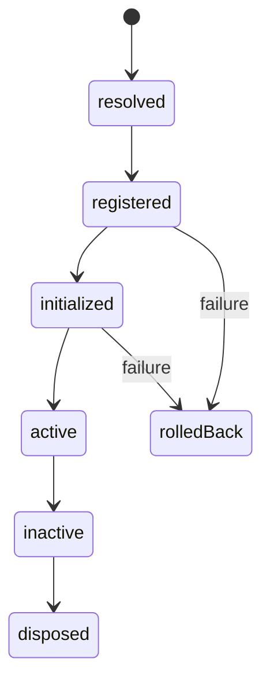

```tsx
import { createPlugin } from "@mwillbanks/tuil-plugin";

const analytics = createPlugin({
  id: "analytics",
  version: "1.0.0",
  setup(context) {
    const contribution = context.routes.register({ id: "analytics" });
    const stopObserving = context.events.observe((event) =>
      console.log(event.type),
    );
    return () => {
      stopObserving();
      contribution.dispose();
    };
  },
});
```

## Rules

- IDs are stable and unique.
- Dependencies name other plugins; capabilities name host features.
- `setup` creates definitions, extension contributions, and subscriptions.
- Dependencies initialize before dependent plugins run `setup`.
- Each setup returns or owns its teardown.
- Health reporting must not mutate application state.


