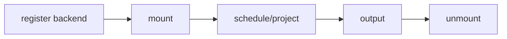

## Overview

Renderer-neutral layout, frame scheduling, terminal integration, and backend contracts for tuil.

`@mwillbanks/tuil-renderer` is independently installable and also participates in the
umbrella `@mwillbanks/tuil` runtime where applicable.

## Installation

```npm
npm install @mwillbanks/tuil-renderer
```

## How it operates

Renderer contracts separate application behavior from backend mount, frame, layout projection, hit testing, terminal session, scheduling, and static-output concerns.



## API

| API | Signature | Description |
| --- | --- | --- |
| [`bracketedPaste`](/docs/reference/packages/renderer/api/bracketed-paste) | `function bracketedPaste` | Public function bracketedPaste. |
| [`ClipRect`](/docs/reference/packages/renderer/api/clip-rect) | `interface ClipRect` | Public interface ClipRect. |
| [`createPlatformClipboardAdapter`](/docs/reference/packages/renderer/api/create-platform-clipboard-adapter) | `function createPlatformClipboardAdapter` | Public function createPlatformClipboardAdapter. |
| [`createRendererComponentRuntime`](/docs/reference/packages/renderer/api/create-renderer-component-runtime) | `function createRendererComponentRuntime` | Creates the renderer-neutral state and behavior boundary used by both Ink and cell backends. Components project the same scene and semantic/layout contracts regardless of the selected output backend. |
| [`defineRendererApplication`](/docs/reference/packages/renderer/api/define-renderer-application) | `function defineRendererApplication` | Public function defineRendererApplication. |
| [`EmbeddedCaptureSnapshot`](/docs/reference/packages/renderer/api/embedded-capture-snapshot) | `interface EmbeddedCaptureSnapshot` | Public interface EmbeddedCaptureSnapshot. |
| [`focusReporting`](/docs/reference/packages/renderer/api/focus-reporting) | `function focusReporting` | Public function focusReporting. |
| [`FrameClock`](/docs/reference/packages/renderer/api/frame-clock) | `interface FrameClock` | Public interface FrameClock. |
| [`FrameScheduler`](/docs/reference/packages/renderer/api/frame-scheduler) | `class FrameScheduler` | Public class FrameScheduler. |
| [`FrameStatistics`](/docs/reference/packages/renderer/api/frame-statistics) | `interface FrameStatistics` | Public interface FrameStatistics. |
| [`isRendererApplication`](/docs/reference/packages/renderer/api/is-renderer-application) | `function isRendererApplication` | Public function isRendererApplication. |
| [`kittyKeyboard`](/docs/reference/packages/renderer/api/kitty-keyboard) | `function kittyKeyboard` | Public function kittyKeyboard. |
| [`LayoutNode`](/docs/reference/packages/renderer/api/layout-node) | `interface LayoutNode` | Public interface LayoutNode. |
| [`LayoutNodeInput`](/docs/reference/packages/renderer/api/layout-node-input) | `type LayoutNodeInput` | Public type LayoutNodeInput. |
| [`LayoutProjection`](/docs/reference/packages/renderer/api/layout-projection) | `class LayoutProjection` | Public class LayoutProjection. |
| [`LayoutSnapshot`](/docs/reference/packages/renderer/api/layout-snapshot) | `interface LayoutSnapshot` | Public interface LayoutSnapshot. |
| [`normalizeRendererHyperlink`](/docs/reference/packages/renderer/api/normalize-renderer-hyperlink) | `function normalizeRendererHyperlink` | Validates a terminal hyperlink before either backend emits OSC 8. Unsafe schemes are rejected even when hyperlinks are unavailable, while safe links are omitted when the terminal cannot render them. |
| [`normalizeRendererScene`](/docs/reference/packages/renderer/api/normalize-renderer-scene) | `function normalizeRendererScene` | Validates and clips the shared scene contract before a backend projects it. This is the parity boundary: backends receive the same safe rows, styles, links, semantics, and cursor geometry. |
| [`osc52Write`](/docs/reference/packages/renderer/api/osc52-write) | `function osc52Write` | Public function osc52Write. |
| [`OutputTarget`](/docs/reference/packages/renderer/api/output-target) | `interface OutputTarget` | Public interface OutputTarget. |
| [`parseOsc52Response`](/docs/reference/packages/renderer/api/parse-osc52-response) | `function parseOsc52Response` | Public function parseOsc52Response. |
| [`PlatformClipboardCommand`](/docs/reference/packages/renderer/api/platform-clipboard-command) | `interface PlatformClipboardCommand` | Public interface PlatformClipboardCommand. |
| [`PlatformClipboardExecutor`](/docs/reference/packages/renderer/api/platform-clipboard-executor) | `type PlatformClipboardExecutor` | Public type PlatformClipboardExecutor. |
| [`RendererApplication`](/docs/reference/packages/renderer/api/renderer-application) | `interface RendererApplication` | Public interface RendererApplication. |
| [`RendererApplicationDriver`](/docs/reference/packages/renderer/api/renderer-application-driver) | `class RendererApplicationDriver` | Owns renderer-independent application projection, state transitions, backend rendering, diffing, output, and cleanup. UI adapters may produce a RendererApplication, but backends never own application state or input. |
| [`RendererApplicationDriverOptions`](/docs/reference/packages/renderer/api/renderer-application-driver-options) | `interface RendererApplicationDriverOptions` | Public interface RendererApplicationDriverOptions. |
| [`RendererBackend`](/docs/reference/packages/renderer/api/renderer-backend) | `interface RendererBackend` | Public interface RendererBackend. |
| [`RendererCapability`](/docs/reference/packages/renderer/api/renderer-capability) | `type RendererCapability` | Public type RendererCapability. |
| [`RendererColor`](/docs/reference/packages/renderer/api/renderer-color) | `type RendererColor` | Public type RendererColor. |
| [`RendererComponent`](/docs/reference/packages/renderer/api/renderer-component) | `type RendererComponent` | Public type RendererComponent. |
| [`RendererComponentContext`](/docs/reference/packages/renderer/api/renderer-component-context) | `interface RendererComponentContext` | Public interface RendererComponentContext. |
| [`RendererComponentRuntime`](/docs/reference/packages/renderer/api/renderer-component-runtime) | `interface RendererComponentRuntime` | Public interface RendererComponentRuntime. |
| [`RendererComponentRuntimeOptions`](/docs/reference/packages/renderer/api/renderer-component-runtime-options) | `interface RendererComponentRuntimeOptions` | Public interface RendererComponentRuntimeOptions. |
| [`RendererConformanceFixture`](/docs/reference/packages/renderer/api/renderer-conformance-fixture) | `interface RendererConformanceFixture` | Public interface RendererConformanceFixture. |
| [`RendererConformanceResult`](/docs/reference/packages/renderer/api/renderer-conformance-result) | `interface RendererConformanceResult` | Public interface RendererConformanceResult. |
| [`RendererContext`](/docs/reference/packages/renderer/api/renderer-context) | `interface RendererContext` | Public interface RendererContext. |
| [`RendererDriverFrame`](/docs/reference/packages/renderer/api/renderer-driver-frame) | `interface RendererDriverFrame` | Public interface RendererDriverFrame. |
| [`RendererFrame`](/docs/reference/packages/renderer/api/renderer-frame) | `interface RendererFrame` | Public interface RendererFrame. |
| [`RendererNamedColor`](/docs/reference/packages/renderer/api/renderer-named-color) | `type RendererNamedColor` | Public type RendererNamedColor. |
| [`RendererOutput`](/docs/reference/packages/renderer/api/renderer-output) | `interface RendererOutput` | Public interface RendererOutput. |
| [`RendererRegistry`](/docs/reference/packages/renderer/api/renderer-registry) | `class RendererRegistry` | Public class RendererRegistry. |
| [`RendererScene`](/docs/reference/packages/renderer/api/renderer-scene) | `interface RendererScene` | Public interface RendererScene. |
| [`RendererTextRun`](/docs/reference/packages/renderer/api/renderer-text-run) | `interface RendererTextRun` | Public interface RendererTextRun. |
| [`RendererTextStyle`](/docs/reference/packages/renderer/api/renderer-text-style) | `interface RendererTextStyle` | Public interface RendererTextStyle. |
| [`ResolvedRendererColor`](/docs/reference/packages/renderer/api/resolved-renderer-color) | `type ResolvedRendererColor` | Public type ResolvedRendererColor. |
| [`resolveRendererColor`](/docs/reference/packages/renderer/api/resolve-renderer-color) | `function resolveRendererColor` | Public function resolveRendererColor. |
| [`runRendererConformance`](/docs/reference/packages/renderer/api/run-renderer-conformance) | `function runRendererConformance` | Public function runRendererConformance. |
| [`ScreenOwnership`](/docs/reference/packages/renderer/api/screen-ownership) | `type ScreenOwnership` | Public type ScreenOwnership. |
| [`TerminalCapabilityDiagnostic`](/docs/reference/packages/renderer/api/terminal-capability-diagnostic) | `interface TerminalCapabilityDiagnostic` | Public interface TerminalCapabilityDiagnostic. |
| [`terminalCapabilityDiagnostics`](/docs/reference/packages/renderer/api/terminal-capability-diagnostics) | `function terminalCapabilityDiagnostics` | Public function terminalCapabilityDiagnostics. |
| [`TerminalControlAdapter`](/docs/reference/packages/renderer/api/terminal-control-adapter) | `interface TerminalControlAdapter` | Public interface TerminalControlAdapter. |
| [`terminalInputModes`](/docs/reference/packages/renderer/api/terminal-input-modes) | `function terminalInputModes` | Public function terminalInputModes. |
| [`terminalNotification`](/docs/reference/packages/renderer/api/terminal-notification) | `function terminalNotification` | Public function terminalNotification. |
| [`TerminalOutputSession`](/docs/reference/packages/renderer/api/terminal-output-session) | `class TerminalOutputSession` | Public class TerminalOutputSession. |
| [`TerminalOutputSessionOptions`](/docs/reference/packages/renderer/api/terminal-output-session-options) | `interface TerminalOutputSessionOptions` | Public interface TerminalOutputSessionOptions. |
| [`terminalTitle`](/docs/reference/packages/renderer/api/terminal-title) | `function terminalTitle` | Public function terminalTitle. |
| [`validateRendererCursor`](/docs/reference/packages/renderer/api/validate-renderer-cursor) | `function validateRendererCursor` | Public function validateRendererCursor. |

## Events and lifecycle

Backends consume normalized input and expose deterministic frame and lifecycle results.

All subscriptions and registrations return a disposer or belong to an owning
runtime that disposes them in reverse order.

## Example

```tsx
import { RendererRegistry } from "@mwillbanks/tuil-renderer";
import { CellRendererBackend } from "@mwillbanks/tuil-cell";

const registry = new RendererRegistry();
const unregister = registry.register(new CellRendererBackend());
unregister();
```

## Related

- [Package architecture](/docs/concepts/packages)
- [Events](/docs/concepts/events)
- [Testing](/docs/guides/testing)
